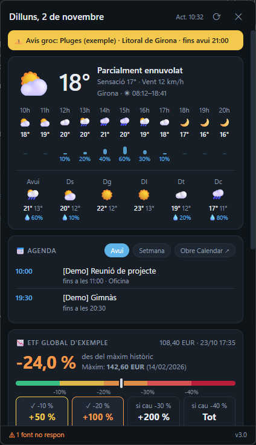
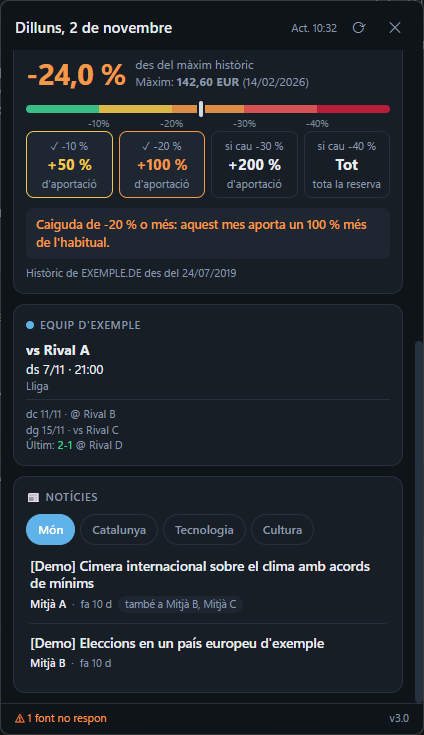
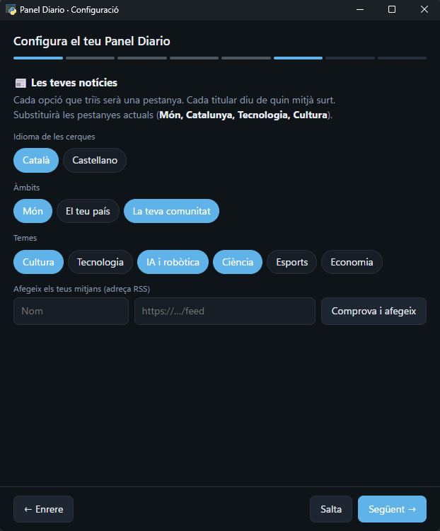
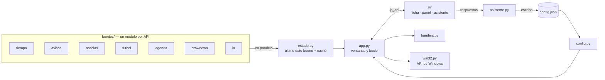

# Panel Diario

[](https://github.com/arni91/panel-diario/actions/workflows/ci.yml)


[](https://docs.astral.sh/uv/)
[](https://docs.astral.sh/ruff/)
[](https://mypy-lang.org/)
[](LICENSE)

**Widget de escritorio para Windows que reúne en un vistazo lo que miro cada mañana**: el tiempo y los avisos de mi ciudad, mi agenda, los partidos de mi equipo, cuánto ha caído un ETF desde su máximo y las noticias de los medios que elijo, cada una con su fuente.

Una píldora en el escritorio muestra la temperatura; un clic despliega el panel. La primera vez, un asistente pregunta qué quieres ver; nada personal está en el código.

<p align="center">
  
  
  
</p>
<p align="center"><sub>Capturas con <code>--demo</code> (datos inventados). Interfaz en catalán.</sub></p>

## Qué hace

| Sección | Detalle | Fuente |
|---|---|---|
| 🌤️ Tiempo y avisos | Ahora, próximas 12 h, 6 días y avisos oficiales de tu zona | Open-Meteo, MeteoAlarm |
| 📅 Agenda | Eventos de hoy y de la semana; enlaces de videollamada clicables | Google Calendar (iCal) |
| ⚽ Fútbol | Próximos partidos y último resultado de tu equipo | football-data.org |
| 📉 Caídas de un ETF | Caída desde el máximo histórico y cuánto aportar de más (en %) en cada nivel | Yahoo Finance |
| 📰 Noticias | Pestañas por ámbito, tema o medio; la misma noticia en varios medios se agrupa; inglés → castellano | RSS, Google Noticias |
| ✨ IA (opcional) | Selecciona las noticias más relevantes y las resume en una línea | API de Claude |

## Aspectos técnicos destacados

- **Integración nativa con Windows sin frameworks pesados**: la píldora se ancla a la capa de iconos del escritorio con la API Win32 (`ctypes`: `SetParent` sobre `SHELLDLL_DefView`), sobrevive a Win+D, recuerda su posición en configuraciones multimonitor y tiene esquinas redondeadas con regiones GDI corregidas por escalado DPI ([`win32.py`](src/panel_diario/win32.py)).
- **Resiliencia**: cada fuente se consulta en paralelo y por separado; si una falla, se muestra su último dato bueno y un aviso en el pie, nunca un panel roto ([`estado.py`](src/panel_diario/estado.py)).
- **Privacidad por diseño en un repositorio público**: toda la configuración personal vive en un `config.json` ignorado por git; un hook de pre-commit (y CI) bloquea cualquier commit que contenga claves, tokens o términos de una lista privada ([`scripts/revisar_privacidad.py`](scripts/revisar_privacidad.py)).
- **Interfaz web dentro de una app de escritorio**: HTML/CSS/JS sin framework en ventanas de [pywebview](https://pywebview.flowrl.com/), comunicadas con Python mediante su puente `js_api`.
- **Agrupación de noticias**: detecta la misma noticia en varios medios por similitud de palabras clave (Jaccard) y elige la versión del medio preferido ([`fuentes/noticias.py`](src/panel_diario/fuentes/noticias.py)).
- **Calidad automatizada**: 66 tests con la red simulada (pytest), tipos estrictos en todas las funciones (mypy), lint y formato (ruff), pre-commit y GitHub Actions en Windows.

## Arquitectura



```
src/panel_diario/
├── app.py            ventanas de pywebview, puente con JavaScript y bucle de actualización
├── config.py         rutas, lectura y escritura de config.json, zona horaria
├── estado.py         último dato bueno de cada sección y caché en disco
├── asistente.py      lógica del asistente de configuración (y su puente con JS)
├── bandeja.py        icono junto al reloj con la temperatura
├── win32.py          llamadas a la API de Windows (ctypes)
├── fuentes/          una fuente de datos por módulo
│   ├── comun.py          HTTP, zona horaria y utilidades de texto compartidas
│   └── tiempo · avisos · noticias · traduccion · ia · futbol · agenda · drawdown
├── ui/               ficha.html (píldora) · index.html (panel) · asistente.html
└── demo.json         datos de demostración (--demo)
tests/                pytest, red simulada: un fichero por módulo
scripts/              revisión de privacidad (pre-commit y CI)
docs/                 referencia de configuración y capturas
```

## Decisiones de diseño

| Decisión | Por qué | Alternativa descartada |
|---|---|---|
| pywebview + HTML | Interfaz moderna con CSS y una app ligera (usa el WebView2 de Windows) | Electron: 100+ MB y otro runtime; Tkinter/Qt: más esfuerzo para el mismo resultado visual |
| Google Calendar por iCal | Solo lectura, sin proyecto en Google Cloud ni pantallas OAuth | API de Google Calendar: más permisos de los necesarios |
| Niveles del ETF en % | El widget no guarda importes: cada uno aplica el % a su aportación | Importes en euros: dato personal dentro de la configuración |
| uv + `uv.lock` | Instalación reproducible y descarga de Python incluida | pip + requirements: sin lock real |
| Errores por fuente, no globales | Un servicio caído no puede dejar el panel en blanco | Un único try global: todo o nada |

## Instalación

Requisitos: Windows 10/11 y [uv](https://docs.astral.sh/uv/) (`winget install astral-sh.uv`). No hace falta instalar Python: uv descarga la versión correcta.

1. Descarga el proyecto (**Code → Download ZIP** o `git clone`) en una carpeta fuera de OneDrive, por ejemplo `C:\dev\PanelDiario`.
2. Doble clic en **`instalar.bat`**: instala las dependencias exactas de `uv.lock`, crea los accesos directos (también para arrancar con Windows) y abre el panel.
3. La primera vez se abre el **asistente**: elige tu ciudad, agenda, equipo, ETF y noticias. Cada paso se puede saltar.

Uso: clic en la píldora para desplegar el panel (otro clic, Esc o clic fuera lo recoge); arrástrala para moverla; **Ctrl+Alt+N** también lo abre. Desde el icono junto al reloj: actualizar, **Configura…** (el asistente) y salir.

La referencia completa de `config.json` está en [docs/configuracion.md](docs/configuracion.md).

## Desarrollo

```bash
uv sync                                      # dependencias + herramientas de desarrollo
uv run pre-commit install                    # ruff, mypy y privacidad antes de cada commit
uv run python -m panel_diario --demo         # interfaz con datos inventados, sin internet
uv run python -m panel_diario --consola      # con el log en la consola
uv run python -m panel_diario --asistente    # abre el asistente al arrancar
uv run pytest                                # tests (red simulada)
uv run ruff check && uv run ruff format --check && uv run mypy
uv run python -m panel_diario.probar_fuentes # comprueba las fuentes reales de tu config.json
```

**Revisión de privacidad**: pon en `.privado/terminos.txt` (fuera de git) lo que nunca debe publicarse —tu ciudad, tu nombre, tus claves—, uno por línea. El hook bloquea el commit si aparece en algún fichero versionado; en CI, sin esa lista, busca solo formas de claves y tokens.

Log en ejecución: `%APPDATA%\PanelDiario\panel.log`.

## Limitaciones conocidas

- Solo Windows: el anclaje al escritorio usa la API Win32.
- Yahoo Finance, el traductor de Google y Google Noticias son servicios no oficiales: pueden fallar puntualmente (el panel muestra el último dato bueno).
- Interfaz solo en catalán; las noticias se muestran en catalán o castellano y el resto se traduce al castellano.

## Licencia

[MIT](LICENSE) · Datos: Open-Meteo, MeteoAlarm, football-data.org, Yahoo Finance, Google Noticias y los medios enlazados en cada titular.
