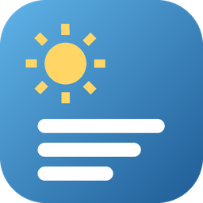

<p align="center"></p>

# Panel Diario

[](https://github.com/arni91/PanelDiario/actions/workflows/ci.yml)


[](LICENSE)

Widget de escritorio para Windows que reúne en un panel el tiempo, la agenda, el deporte, la bolsa y las noticias de los medios que elija cada usuario. Una píldora en el escritorio muestra la temperatura; un clic despliega el panel. La primera vez, un asistente lo configura todo con listas y casillas.

<p align="center">
  
  
  
</p>
<p align="center"><sub>Capturas con <code>--demo</code> (datos inventados). Interfaz en catalán.</sub></p>

## Funciones

| Sección | Qué muestra | Fuente de datos |
|---|---|---|
| Tiempo | Ahora, próximas horas, 6 días y avisos oficiales | Open-Meteo, MeteoAlarm |
| Agenda | Eventos de hoy y de la semana | Calendario iCal (Google, Outlook, iCloud) |
| Deportes | Próximos partidos y último resultado de los equipos elegidos (fútbol, baloncesto, fútbol americano, hockey sobre hielo y béisbol), la Fórmula 1 y MotoGP | ESPN, motogp.com |
| Bolsa | Índices con la variación del día y los valores que más suben, bajan o se negocian | Yahoo Finance |
| ETF propio (opcional) | Caída desde el máximo y aportación extra por niveles (en %) | Yahoo Finance |
| Noticias | 56 medios para elegir (Catalunya, España, Europa, mundo, temáticos y revistas) y secciones por tema; «Portades» resume las noticias principales de todas las portades. Cada titular en su idioma, con traducción opcional | RSS, Google Noticias |

## Stack

| Capa | Tecnología |
|---|---|
| Lenguajes | Python 3.12 · HTML, CSS y JavaScript (sin framework) |
| Interfaz de escritorio | [pywebview](https://pywebview.flowrl.com/) (WebView2) · pystray (icono de la bandeja) · API Win32 con `ctypes` |
| Datos | `requests` · `feedparser` (RSS) · `icalendar` |
| Entorno y dependencias | [uv](https://docs.astral.sh/uv/) con `uv.lock` |
| Calidad | pytest (red simulada) · mypy estricto · ruff · pre-commit |
| CI | GitHub Actions en Windows |

## Arquitectura

```
src/panel_diario/
├── app.py          arranque, ventanas, puente Python ↔ JavaScript y bucle de actualización
├── config.py       lectura y escritura de config.json
├── state.py        último dato bueno de cada sección y caché
├── sources/        back: una fuente de datos por módulo (HTTP común en comun.py)
├── catalog/        datos públicos: catálogo de medios con sus feeds RSS
├── wizard/         lógica del asistente de configuración
├── desktop/        integración con Windows: icono de la bandeja y API Win32
└── ui/             front: una carpeta por ventana (panel, pill, wizard) con HTML, CSS y JS
tests/              misma estructura que src/
scripts/            revisión de privacidad (pre-commit y CI)
docs/               referencia de configuración y catálogo de medios
```

Principios: cada fuente se consulta en paralelo y por separado, y si una falla se muestra su último dato bueno; la configuración personal vive solo en `config.json`, fuera de git; los secretos (como la dirección iCal) nunca llegan al log.

## Instalación

Requisitos: Windows 10/11 y [uv](https://docs.astral.sh/uv/) (`winget install astral-sh.uv`). uv descarga Python.

1. Descarga el repositorio (**Code → Download ZIP** o `git clone`).
2. Ejecuta **`instalar.bat`**: instala las dependencias, crea los accesos directos y abre el panel.
3. Sigue el asistente. Cada paso se puede saltar y cambiar después desde el icono junto al reloj → **Configura…**

Uso: clic en la píldora para abrir el panel, arrastrar para moverla, **Ctrl+Alt+N** para abrirlo. Referencia completa de `config.json`: [docs/configuracion.md](docs/configuracion.md).

## Desarrollo

```bash
uv sync                                   # dependencias y herramientas de desarrollo
uv run pre-commit install                 # comprobaciones antes de cada commit
uv run python -m panel_diario --demo      # interfaz con datos inventados
uv run pytest                             # tests
uv run ruff check && uv run mypy          # lint y tipos
```

## Licencia

[MIT](LICENSE)
